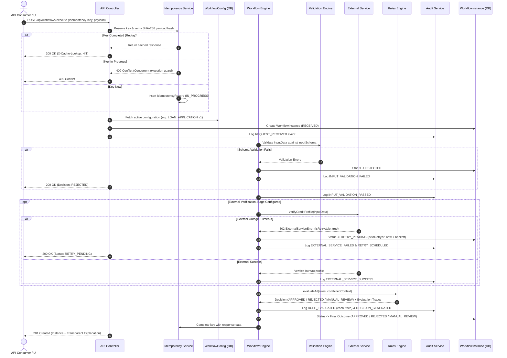
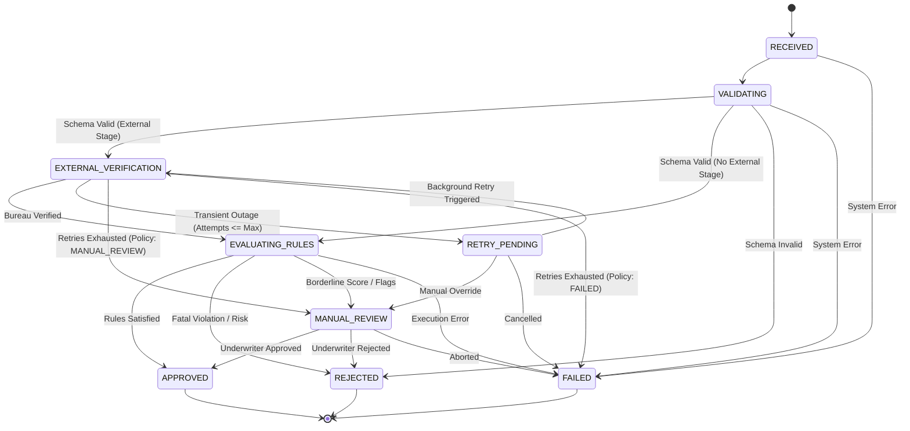

# Architectural Specification: Configurable Workflow Decision Platform

## 1. Executive Summary & Objective

The **Configurable Workflow Decision Platform** is an enterprise-grade, configuration-driven decisioning and workflow orchestration engine. Built with a modular monolithic architecture in Node.js (ES Modules) and MongoDB, the system automates multi-stage evaluations of structured incoming applications (e.g., Loan Approval, Insurance Claim Processing, Vendor Onboarding).

The platform guarantees:
- **Zero hardcoded business rules**: Rule criteria, logical operators, priorities, stages, and thresholds reside in versioned database configurations.
- **Explainable Decisions**: Every evaluated rule generates transparent pass/fail traces explaining the precise mathematical justification.
- **Resilient Fault Handling**: Transient external dependencies (e.g., Credit Bureaus) trigger exponential backoff retries and non-blocking background resolution.
- **Strict Concurrency & Idempotency**: Distributed atomic locks and deterministic SHA-256 payload integrity hashing eliminate duplicate executions and double-charging risks.
- **Append-Only Auditing**: Immutable event sourcing of every state transition, external enrichment call, rule evaluation, and human override.

---

## 2. High-Level System Architecture

```mermaid
flowchart TD
    Client["Client / Evaluator UI / API Consumer"] -->|HTTP REST / Idempotency-Key| Gateway["API Routing & Security Middleware Layer"]
    
    subgraph Core Platform ["Configurable Decision Platform (Modular Monolith)"]
        Gateway --> IdemService["Idempotency Interceptor & Integrity Hash"]
        IdemService --> AuthMiddleware["RBAC Authorization Middleware"]
        AuthMiddleware --> WorkflowCtrl["Workflow Orchestrator Controller"]
        
        WorkflowCtrl --> StateMachine["State Machine & Transition Guards"]
        StateMachine --> ValEngine["Dynamic JSON-Schema Validation Engine"]
        StateMachine --> ExtAdapter["External Dependency Adapter (SimEngine)"]
        StateMachine --> RulesEngine["Generic Business Rules Evaluator"]
        StateMachine --> Explainer["Decision Explanation Synthesizer"]
        
        RetryWorker["Background Retry Loop (Non-blocking)"] -.->|Polls RETRY_PENDING| StateMachine
        AuditService["Append-Only Audit Event Bus"] <==|Log Transitions & Traces| StateMachine
    end
    
    subgraph Data Tier ["Persistence Layer (MongoDB)"]
        WorkflowConfig[("WorkflowConfig Collection\n(Versioned Definitions)")]
        WorkflowInstance[("WorkflowInstance Collection\n(Lifecycle State)")]
        AuditLog[("AuditLog Collection\n(Immutable Log)")]
        IdempotencyRecord[("IdempotencyRecord Collection\n(Atomic Unique Lock)")]
    end
    
    ValEngine -.->|Read Schema| WorkflowConfig
    RulesEngine -.->|Read Rules & Priority| WorkflowConfig
    StateMachine -->|Save State| WorkflowInstance
    AuditService -->|Append-Only| AuditLog
    IdemService -->|Atomic Lock / Cache| IdempotencyRecord
```

---

## 3. Component Responsibilities & Module Boundaries

| Component | Responsibility & Design Guard |
|---|---|
| **API Layer** (`src/controllers/`, `src/routes/`) | Thin HTTP endpoints returning standardized `{ success, data, error }` envelopes, enforcing status codes and RBAC headers (`x-user-role`). |
| **Validation Engine** (`src/engines/validationEngine.js`) | Dynamic schema-based type coercion, range validation, mandatory field checks, and structured error reporting. |
| **Rules Engine** (`src/engines/rulesEngine.js`) | Pure, decoupled rule evaluator supporting atomic comparisons, compound `AND`/`OR` logic, priority ordering, and mandatory requirements. |
| **Workflow Engine** (`src/engines/workflowEngine.js`) | Stage orchestrator enforcing deterministic transitions between `RECEIVED`, `VALIDATING`, `EXTERNAL_VERIFICATION`, `EVALUATING_RULES`, and terminal outcomes. |
| **External Service Adapter** (`src/services/externalService.js`) | Isolated credit bureau adapter with deterministic fault injection (`forceFailure`, `forceTimeout`, `failureType`), latency simulation, and error classification. |
| **Retry Manager** (`src/services/retryService.js`) | Non-blocking backoff scheduler managing `RETRY_PENDING` states, tracking retry counts, calculating exponential backoff, and triggering exhaustion routing. |
| **Idempotency Service** (`src/services/idempotencyService.js`) | Atomic state reservation (`IN_PROGRESS` vs `COMPLETED`), SHA-256 payload integrity hashing, and cached response replay. |
| **Audit Service** (`src/services/auditService.js`) | Append-only immutable log recorder tracking state transitions, rule traces, external calls, and underwriter overrides. |
| **Explanation Service** (`src/services/explanationService.js`) | Synthesizes explainable, human-readable rationales directly from actual evaluation results. |

---

## 4. End-to-End Data Flow



---

## 5. Workflow State Machine & Transition Matrix

The orchestrator enforces strict state transition guards. Illegal transitions (e.g., transitioning from `RECEIVED` directly to `APPROVED`, or altering terminal states) are rejected with a `TransitionError`.



### Transition Guard Table
| Current Status | Permitted Target Statuses | Notes |
|---|---|---|
| `RECEIVED` | `VALIDATING`, `FAILED` | Intake only |
| `VALIDATING` | `EXTERNAL_VERIFICATION`, `EVALUATING_RULES`, `REJECTED`, `FAILED` | Schema validation |
| `EXTERNAL_VERIFICATION` | `EVALUATING_RULES`, `RETRY_PENDING`, `MANUAL_REVIEW`, `FAILED` | Bureau call |
| `RETRY_PENDING` | `EXTERNAL_VERIFICATION`, `MANUAL_REVIEW`, `FAILED` | Backoff wait state |
| `EVALUATING_RULES` | `APPROVED`, `REJECTED`, `MANUAL_REVIEW`, `FAILED` | Dynamic rules engine |
| `MANUAL_REVIEW` | `APPROVED`, `REJECTED`, `FAILED` | Underwriter override |
| `APPROVED` | *(Terminal)* | Immutable |
| `REJECTED` | *(Terminal)* | Immutable |
| `FAILED` | *(Terminal)* | Immutable |

---

## 6. Engineering Robustness & Reliability Deep-Dive

### A. Idempotency & Concurrency Design
- **Unique Atomic Lock**: The database maintains a unique compound index on `IdempotencyRecord.key`.
- **Integrity Validation**: A SHA-256 hash of the normalized request body and `workflowType` is stored in the record. If the client submits the same `Idempotency-Key` with an altered payload, the request is rejected with `409 Conflict: Idempotency key payload mismatch`.
- **Concurrent In-Flight Blocking**: When a second request arrives while the first is `IN_PROGRESS`, the atomic constraint returns `409 Conflict`, preventing duplicate concurrent thread executions or double charging.
- **Cache Replay**: Completed requests return the stored response with `X-Cache-Lookup: HIT` without re-evaluating rules or appending duplicate audit events.

### B. Retry Strategy & Exponential Backoff
- When an external dependency fails with a transient error (e.g. `TIMEOUT`, `EXTERNAL_SERVICE_UNAVAILABLE`, `RATE_LIMITED`):
  1. The engine checks `WorkflowConfig.retryPolicy`.
  2. If `executionAttempts <= maxRetries`, status becomes `RETRY_PENDING`.
  3. The next retry timestamp is calculated using exponential backoff:
     $$\text{Delay} = \text{initialDelayMs} \times (\text{backoffMultiplier})^{\text{attempts} - 1}$$
     *Example with initial 1,000ms & multiplier 2: Attempt 1 $\rightarrow$ 1,000ms, Attempt 2 $\rightarrow$ 2,000ms, Attempt 3 $\rightarrow$ 4,000ms.*
  4. The background retry loop queries for records with `status: 'RETRY_PENDING'` and `nextRetryAt <= now()`, executing retries without blocking HTTP connections.
  5. If retries are exhausted, the workflow transitions according to `retryPolicy.onExhaustion` (`MANUAL_REVIEW` or `FAILED`).

### C. Configuration Versioning & Immutability
- Changing business rules never modifies past decisions.
- Every workflow execution snapshots the exact `workflowConfigId` and integer `workflowConfigVersion` under which it executed.
- When an administrator publishes updated underwriting rules, a new version document (e.g., $v2$) is inserted into MongoDB. Existing applications in review or historical records remain bound to $v1$.

---

## 7. Trade-Off Defense

| Architectural Decision | Alternative Considered | Justification & Trade-off Defense |
|---|---|---|
| **Modular Monolith vs Microservices** | Microservices Architecture | A modular monolith with strict domain module boundaries provides zero network hop latency, transactional reliability, and effortless local hackathon deployment while preserving cleanly decoupled boundaries that can be extracted into microservices when team scale demands it. |
| **Embedded JSON Rules Engine vs External Rule Engine (Drools / Camunda)** | Heavyweight External Engine (e.g. Camunda, Drools) | External engines introduce heavy JVM dependencies and complex operational overhead. Our custom JSON-schema rules engine is lightweight, stores rules directly in MongoDB, evaluates in $< 2\text{ms}$, and supports arbitrary logical expressions without external servers. |
| **Database Atomic Indexing vs Distributed Redis Lock** | Redis / Redlock | Using MongoDB unique indexes for idempotency eliminates dual-write consistency problems between an external cache and the database. The single source of truth guarantees zero phantom records upon database failure. |
| **Append-Only Audit Collection vs Event Sourcing Event Store** | Full Event Sourcing (CQRS/ES) | Full event sourcing introduces eventual consistency lag and projection complexity. An append-only `AuditLog` collection with Mongoose transactions provides 100% audit compliance and chronological explainability while keeping relational reads simple and fast. |

---

## 8. Horizontal Scaling & Future Growth Considerations

1. **Distributed Background Worker**:
   The current background worker runs in-process with a timer. In a multi-replica Kubernetes cluster, this can be transitioned to a MongoDB-backed distributed lock (e.g., `agenda` or BullMQ with Redis) ensuring each `RETRY_PENDING` instance is claimed exclusively by one pod via `findOneAndUpdate`.
2. **Database Sharding**:
   - `WorkflowInstance` can be sharded on `workflowType` + `createdAt`.
   - `AuditLog` can be sharded on `workflowInstanceId`.
   - `IdempotencyRecord` utilizes a 24-hour TTL index to automatically purge expired records.
3. **Transactional Outbox for External Events**:
   To publish workflow outcomes to Kafka or RabbitMQ for downstream notifications, an Outbox table can be written within the same MongoDB transaction, guaranteeing at-least-once message delivery.

